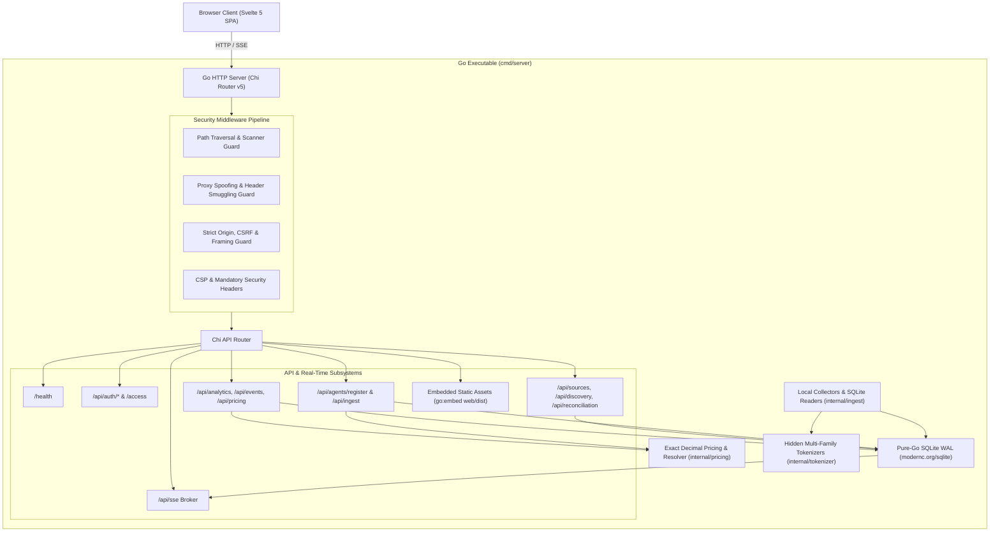

# Architecture Specification: Go + Svelte 5 Single Binary

This document summarizes the implemented Go + Svelte 5 single-binary architecture of **AI Usage Monitor** and its verification baseline (see [INVARIANTS.md](./INVARIANTS.md) for inviolable guarantees).

---

## 1. System Architecture

AI Usage Monitor compiles to a single, CGo-free Go executable (`bin/ai-usage-monitor`) embedding the compiled Svelte 5 SPA via `go:embed`.



---

## 2. Go Backend Package Structure (`cmd/`, `internal/`)

```
cmd/
  server/
    main.go               # Entrypoint, flags/config, graceful shutdown, external resolver wiring
web/
  embed.go                # //go:embed all:dist
internal/
  api/
    router.go             # Chi router, auth/session enforcement, static asset serving
    auth_handlers.go      # Cookie session login, logout, revoke, access token verification
    usage_handlers.go     # /api/analytics, /api/events, /api/sources, /api/discovery, /api/pricing, /api/reconciliation
    ingest_handlers.go    # /api/agents/register, /api/ingest (Bearer auth + rate declaration)
    sse_handler.go        # /api/sse live stream
  auth/                   # Machine-key Argon2id/HMAC token verification & signed sessions
  config/                 # Environment + JSON config loader (8 local roots + opt-in pricing sync)
  db/
    sqlite.go             # Pure-Go SQLite WAL setup, migrations, RateResolver wiring
    schema.go             # events, dynamic_pricing, text_measurements, cursors, errors, agents
    events.go             # Atomic event insertion, auto-pricing resolution, reconciliation storage
    queries.go            # Analytics, pagination, observed-only pricing, canonical agent filtering
  ingest/
    adapters.go           # Local specs for codex, opencode, claude, antigravity, gemini, cursor, copilot, hermes
    collector.go          # Safe O_NOFOLLOW/O_NONBLOCK JSONL reader, same-size rewrite detection, silent tokenizer fallback
    sqlite_reader.go      # OpenCode SQLite reader + silent tokenizer fallback
    discovery.go          # Local technology auto-discovery & manager
  pricing/
    decimal.go            # Exact shopspring/decimal helpers
    normalize.go          # Provider/aggregator/Bedrock/date/version canonicalization
    catalog.go            # Verified Nov 2026 internal catalog, deprecated models, long-context & schedules
    estimate.go           # Fail-closed cost estimator
    resolver.go           # Opt-in external catalog resolver (models.dev, LiteLLM, OpenRouter) + 0600 disk cache
  security/
    guard.go              # Path traversal & scanner rejection
    headers.go            # Strict CSP (style-src 'self', script-src 'self') & security headers
    proxy.go              # Loopback proxy spoofing & duplicate header defense
    origin.go             # Origin allowlist, loopback aliases, framing prevention
  sse/
    broker.go             # Thread-safe SSE channel fan-out
  tokenizer/
    registry.go           # Auto-selection across OpenAI, Claude, Gemini, Mistral, MiniMax, Z.AI GLM, DeepSeek, Qwen, Kimi, Llama/Grok
    pretokenize.go        # Pure-Go Unicode & SentencePiece pre-tokenizers
    bpe.go                # Pure-Go BPE, HuggingFace tokenizer.json, and protobuf SentencePiece Unigram
    engine.go             # Thread-safe silent fallback counter (2 MiB cap, zero network I/O)
```

---

## 3. Frontend Structure (`web/`)

Svelte 5 (runes `$state`, `$derived`, `$effect`), TypeScript, Vite, zero inline styles:

```
web/
  index.html
  public/
    theme-init.js         # External anti-FOUC bootstrap script
    fonts/                # Self-hosted Inter variable WOFF2
    icons/                # Monochrome SVG icons (no inline style attributes)
  src/
    app.css               # 4 themes × dark/light WCAG AA tokens, tabular-nums, reduced-motion
    main.ts               # Svelte 5 mount
    App.svelte            # Active-view-only data loader, SSE subscription, requestSeq ordering
    components/
      Header.svelte       # Sticky header, live SSE indicator, theme/mode switches
      Sidebar.svelte      # 3 views + canonical agent filters
      OverviewView.svelte # KPIs, charts, per-agent cards, observed models disclosure
      HistoryView.svelte  # Accessible ul/li + details expandable history & pagination
      SourcesView.svelte  # Local & HTTP agent discovery, reconciliation, error log
      AccessView.svelte   # Session authentication view
      AgentIcon.svelte    # SVG agent silhouettes
    lib/
      agents.ts           # Canonical agent ID normalization & metadata
      viewLoader.ts       # Active-tab endpoint planner
      api.ts              # Typed HTTP client
      sse.ts              # SSE subscriber
      theme.svelte.ts     # Reactive theme/mode state
      types.ts            # Shared API interfaces
```

---

## 4. Verification Baseline

1. `gofmt -l cmd internal web` produces empty output.
2. `CGO_ENABLED=0 go vet ./...` passes cleanly.
3. `cd web && npm run check && npm test && npm run build` passes cleanly.
4. `CGO_ENABLED=0 go test -count=1 -v ./...` passes all Go unit and integration tests.
5. `CGO_ENABLED=0 go build -o bin/ai-usage-monitor ./cmd/server` produces the standalone binary.
6. `cd web && npm run test:e2e` validates live Chromium rendering, WCAG AA contrast across all 8 theme variants, active-view-only fetching, History ARIA semantics, zero inline styles / zero CSP violations, and zero tokenizer UI exposure.
